<!--
author:    [Dein Name]
email:     [deine.mail@ovgu.de]
version:   1.0.0
language:  de
narrator:  Deutsch Female
mode:      Presentation
logo:      images/CTA198558_TVM1406142.png

title:     Sicherheit und Gesundheit bei der Arbeit
comment:   Fachinput (70 Min.) mit Fallstudie (20 Min.) im Seminar "Ingenieurpädagogisches Labor", WiSe 2026/27. Grundlage: Vorjahrespräsentation (Dozent M. Robra, 09.11.2020) und Arbeitsblatt Unterrichtsmethoden.
-->

# Sicherheit und Gesundheit bei der Arbeit

**Ingenieurpädagogisches Labor** · WiSe 2026/27
Themenfeld 1: Sicherheit und Gesundheitsschutz

Gruppen-Input: [Name 1] · [Name 2] · [Name 3]
Master Lehramt an berufsbildenden Schulen · Otto-von-Guericke-Universität Magdeburg

## Ablauf und Zeitplan

| Block | Inhalt | Zeit |
|:--|:--|--:|
| 0 | Einstieg: Bildimpuls, Vorwissen, Lernziele | 6 Min. |
| 1 | Wandel der Arbeitswelt | 10 Min. |
| 2 | Arbeitsschutz: Definition und ganzheitliches Verständnis | 12 Min. |
| 3 | Duales Arbeitsschutzsystem | 10 Min. |
| 4 | Rechtliche Grundlagen: von der EU-Richtlinie bis zur Norm | 18 Min. |
| 5 | Institutionen und betriebliche Akteure | 10 Min. |
| 6 | Zusammenfassung | 4 Min. |
| **Input gesamt** | | **70 Min.** |
| A | **Aktivierung: Fallstudie** | **20 Min.** |

---

## Einstieg: Bildimpuls

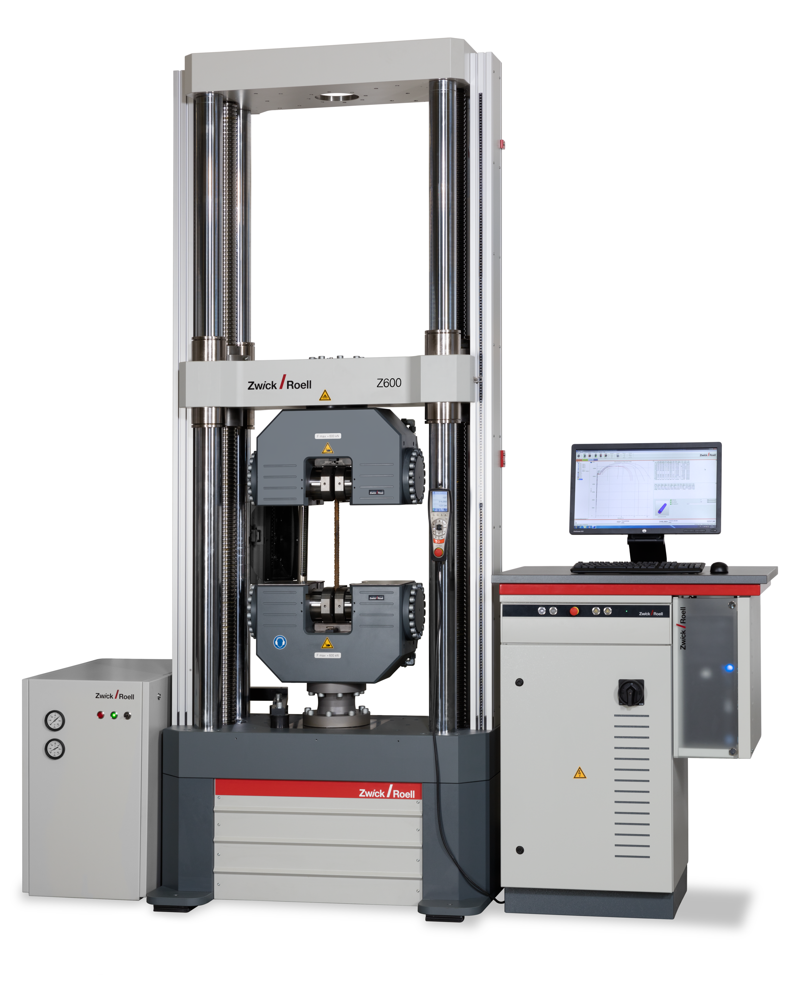<!-- style="max-height: 55vh;" -->

Quelle: ZwickRoell, Produktabbildung Universalprüfmaschine Z600 (F max = 600 kN) [Quelle bitte prüfen]

**Impuls:** Sie sollen diese Prüfmaschine im Werkstofflabor einsetzen.

1. Welche **Gefährdungen** erkennen Sie? (Hinweis: Schauen Sie auf die Piktogramme.)
2. **Wer** ist dafür verantwortlich, dass hier nichts passiert?
3. **Welche Regeln** kennen Sie aus Ihrer Berufspraxis dazu?

---

## Einstieg: Vorwissen abfragen

**Wissensstand-Check 1:** Wer ist nach dem Arbeitsschutzgesetz in erster Linie für Sicherheit und Gesundheit der Beschäftigten verantwortlich?

- [( )] Die Beschäftigten selbst
- [(X)] Der Arbeitgeber
- [( )] Die Berufsgenossenschaft
- [( )] Das Gewerbeaufsichtsamt
********************

Der Arbeitgeber hat die umfassende, vorausschauende Handlungspflicht (ArbSchG). Fachkräfte für Arbeitssicherheit und Betriebsärzte unterstützen ihn nach ASiG. Wir kommen darauf zurück.

********************

**Wissensstand-Check 2:** Welche dieser Dinge sind **rechtsverbindlich**? (Mehrfachauswahl)

- [[X]] Gesetze
- [[X]] Verordnungen
- [[ ]] DIN-Normen
- [[ ]] Technische Regeln
********************

Gesetze und Verordnungen sind zwingend einzuhalten. Normen und Technische Regeln sind generell nicht rechtsverbindlich. Warum sie trotzdem wichtig sind, klären wir in Block 4.

********************

---

## Lernziele

Am Ende des Inputs können Sie ...

1. **nennen:** sechs Trends des Wandels der Arbeitswelt und ihre Auswirkungen auf den Arbeitsschutz.
2. **erläutern:** die Definition des Arbeitsschutzes und sein ganzheitliches Verständnis (Schutz, Förderung, Selbstverantwortung).
3. **beschreiben:** das duale Arbeitsschutzsystem in Deutschland (Staat, Unfallversicherungsträger, private Normgeber).
4. **ordnen:** Rechtsquellen von der EU-Richtlinie bis zur Norm nach ihrer Verbindlichkeit.
5. **benennen:** Rollen und Aufgaben betrieblicher Akteure (Arbeitgeber, Fachkraft für Arbeitssicherheit, Betriebsarzt).
6. **anwenden:** Rechtsquellen und Akteure auf einen Laboraufbau übertragen (Fallstudie).

---

## Block 1: Wandel der Arbeitswelt

Trends und Strukturwandel in Verwaltung, Wirtschaft und Gesellschaft

- Globalisierung
- Technologien
- Dienstleistungsgesellschaft
- Wissensgesellschaft
- Demografischer Wandel
- Wertewandel

Quelle: DGUV 251-001

---

## Trend 1 von 6: Globalisierung

- Staaten und Wirtschaftsräume rücken zusammen
- EU als großer Wirtschaftsraum und Normen- und Regelsetzer
- weltweite Verflechtung von Gütern, Kapital, Produktion und Dienstleistungen
- globale Wertschöpfungsketten

Quelle: DGUV 251-001

---

## Trend 2 von 6: Technologien

- Innovationsschübe in Mikroelektronik und -systemtechnik, Digitalisierung, Miniaturisierung
- Informations- und Kommunikationstechnologien: Wirkungen auf Wirtschaft und Gesellschaft, Arbeit und Freizeit
- Medizin, Bio- und Gentechnik, Material- und Stoffentwicklung
- Beeinflussung von Forschung, Produktion, Dienstleistung und Gesundheit

Quelle: DGUV 251-001

---

## Trend 3 von 6: Dienstleistungsgesellschaft

- im Verhältnis zum produzierenden Gewerbe steigt der Anteil der Dienstleistungen
- Erwartungen und Verhalten von Menschen und Organisationen entwickeln sich zu einer gewissen Selbstverständlichkeit
- prägt Märkte, Unternehmensstrukturen, Produkte und Konsumenten

Quelle: DGUV 251-001

---

## Trend 4 von 6: Wissensgesellschaft

- zunehmend unüberschaubares, weltweit jederzeit verfügbares Wissen
- Wissen als Grundlage für Innovation, Kreativität und flexible Reaktion
- Wissen wird zum wesentlichen Produktionsfaktor
- Herausforderungen an die Fähigkeiten und das Lernen der Menschen

Quelle: DGUV 251-001

---

## Trend 5 von 6: Demografischer Wandel

- veränderte Wünsche und Erwartungen der Beschäftigten, hoher Altersdurchschnitt
- Altersstruktur sowie kulturelle und Geschlechterzusammensetzung
- Wandel des Erfahrungs- und Qualifikationsniveaus der Bewerber
- Erhalt der Arbeits- und Leistungsfähigkeit und Gesundheit der Beschäftigten

Quelle: DGUV 251-001

---

## Trend 6 von 6: Wertewandel

- Arbeit vs. Freizeit
- Bildungsgesellschaft: lebenslanges Lernen
- Vereinbarkeit von Familie und Beruf
- Vergütung

Quelle: DGUV 251-001

---

## Wirkungen auf Wirtschaft, Verwaltung und Arbeitsformen

**Traditionelle wirtschaftliche Strukturen verändern sich**

- Branchen und regionale Prägungen verlieren an Bedeutung, neue Branchen wie Logistik und Medienbetriebe wachsen
- Unternehmensstrukturen wandeln sich von festen Einheiten zu losen Netzwerken
- Outsourcing- und Reorganisationsprozesse

**Modernisierung öffentlicher Verwaltungen**

- Privatisierung öffentlicher Aufgaben wird diskutiert und teils vollzogen
- Dienstleistungsorientierung, Onlinedienste, integrierte Informationsplattformen

**Arbeitsformen**

- Vollzeit/Teilzeit · Telearbeit · Leiharbeit · Solo-Selbstständigkeit/Freelancer

Quelle: DGUV 251-001

---

## Veränderte Arbeitsbedingungen

| Veränderung | Beispiele |
|:--|:--|
| **Virtualisierung der Arbeitsgegenstände** | Informationen direkt am Bildschirm, keine physischen Werkstücke oder Akten, virtueller Zwilling |
| **Von IT geprägte Arbeitsmittel** | computergesteuerte Arbeitsmittel, Monitoring, Remote-Systeme |
| **Neue Arbeitsorganisations- und Kommunikationsformen** | Gruppen- und Teamarbeit, Dezentralisierung von Verantwortung, flachere Hierarchien, Projektgruppen, variable Arbeitszeiten und -orte |
| **Neue Arbeitsverfahren** | kürzere Innovations- und Technologieschübe, bekannte Verfahren unter veränderten Bedingungen |

Quelle: DGUV 251-001

---

## Neue Belastungskonstellationen

- **Psychische Belastungen** aus Arbeitsmenge, Arbeitsorganisation und sozialem Umfeld nehmen stark zu
- **Traditionelle mechanische Gefährdungsfaktoren** und körperlich schwere Arbeit sinken
- **Mechanisierung und Automatisierung** steigen, ebenso Outsourcing und Vernetzung
- Physikalische, chemische, biologische und psycho-physiologische Faktoren **ändern die Belastungskonstellationen**
- Das verändert Reaktionen und Beanspruchungen des Menschen und erfordert die **ganzheitliche Gestaltung von Arbeitssystemen**

Quelle: DGUV 251-001

---

## Diskussion: Trends und Ihr späterer Unterricht

**💬 Austausch (3 Min.)**

Sie bilden künftig Auszubildende für eine Arbeitswelt aus, die sich schnell wandelt.

1. Welcher der sechs Trends wird die **Arbeitsplätze Ihrer Auszubildenden** am stärksten verändern? Welche **neue Gefährdung oder Belastung** entsteht dadurch?
2. Was bedeutet das für Ihren **Unterricht im Labor**? Welche Sicherheits- und Gesundheitskompetenzen müssen Ihre Schülerinnen und Schüler aufbauen?

*Denkanstoß:* Fernüberwachung und vernetzte Prüfstände, psychische Belastung, wechselnde Teams, Selbstverantwortung ...

---

## Folgen für das betriebliche Arbeitsschutzhandeln

> Klassische Handlungsmuster des Arbeitsschutzes und eine Beschränkung auf sicherheitstechnische und verwandte Disziplinen führen **nicht mehr** zu problemangemessenen Lösungen.
>
> Für Arbeitssicherheit sind zunehmend **weniger Detailkenntnisse** einzelner technologischer Verfahren, Maschinen, Anlagen und darauf bezogener Sicherheitskonzepte von Bedeutung.
>
> Arbeitssicherheit muss **problembezogenes Wissen und Methoden aus verschiedenen Fachdisziplinen vernetzen**.

Quelle: DGUV 251-001, S. 10 (sinngemäß aus Folie "Wandel Arbeitswelt auf das betriebliche Arbeitsschutzhandeln")

---

## Wandel des betrieblichen Arbeitsschutzhandelns

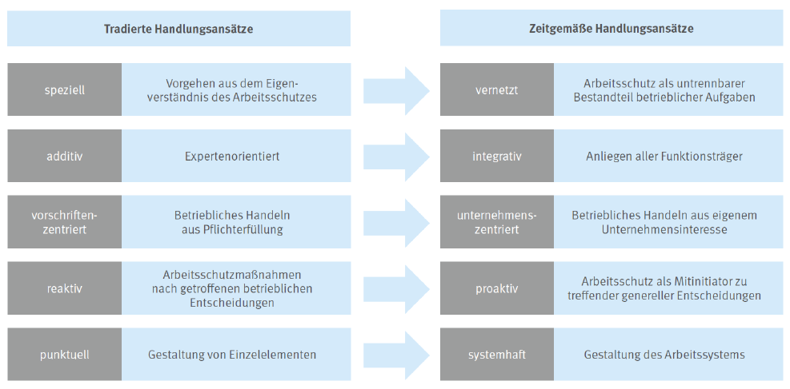<!-- style="max-height: 60vh;" -->

Quelle: DGUV 251-001, S. 10

---

## Wissensstand-Check 3: Handlungsansätze

Ein Betrieb ergreift Arbeitsschutzmaßnahmen erst **nach** einem Unfall und gestaltet nur einzelne Maschinen um. Welche Handlungsansätze liegen vor?

- [( )] vernetzt und proaktiv
- [(X)] reaktiv und punktuell
- [( )] integrativ und systemhaft
- [( )] unternehmenszentriert und additiv
********************

Reaktiv: Maßnahmen nach getroffenen Entscheidungen bzw. Ereignissen. Punktuell: Gestaltung von Einzelelementen statt des Arbeitssystems. Zeitgemäß wäre proaktiv und systemhaft.

********************

Welcher Ansatz passt zu **„Arbeitsschutz als untrennbarer Bestandteil betrieblicher Aufgaben"**?

[[(vernetzt)|speziell|punktuell|reaktiv]]
********************

Vernetzt: Arbeitsschutz ist ein untrennbarer Bestandteil betrieblicher Aufgaben.

********************

---

## Block 2: Arbeitsschutz – eine Definition

> **Arbeitsschutz** ist Bewahrung von **Leben und Gesundheit** in Verbindung mit der Arbeit.

Er umfasst:

- den **Schutz vor arbeitsbedingten Unfallgefahren** und arbeitsbedingten Gesundheitsgefahren,
- den **Erhalt der gesundheitlichen Ressourcen** über eine aktive Gesundheitsförderung im Sinne der Einflussnahme auf körperliches, geistiges und soziales Wohlbefinden,
- dazu gehören eine **menschengerechte Gestaltung** und ständige Verbesserung der Arbeit bzw. **sichere und gesundheitsgerechte Arbeitssysteme**, damit diese den körperlichen und geistigen Leistungsvoraussetzungen der Beschäftigten entsprechen.

Quelle: DGUV, Sifa – Fachkraft für Arbeitssicherheit (2020)

---

## Ganzheitliche Auffassung von Sicherheit und Gesundheit

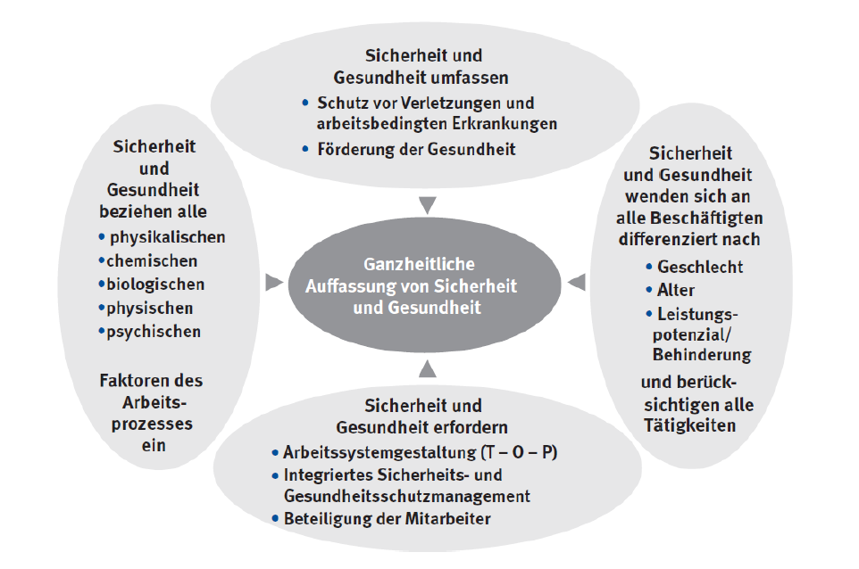<!-- style="max-height: 62vh;" -->

Quelle: DGUV Report 2/2012, S. 18

- Schutz vor Verletzungen und arbeitsbedingten Erkrankungen **und** Förderung der Gesundheit
- alle **physikalischen, chemischen, biologischen, physischen und psychischen** Faktoren
- alle Beschäftigten, differenziert nach Geschlecht, Alter und Leistungspotenzial/Behinderung
- erfordert Arbeitssystemgestaltung (T-O-P), integriertes Management, Beteiligung der Mitarbeiter

---

## Schutzaspekt und Förderungsaspekt

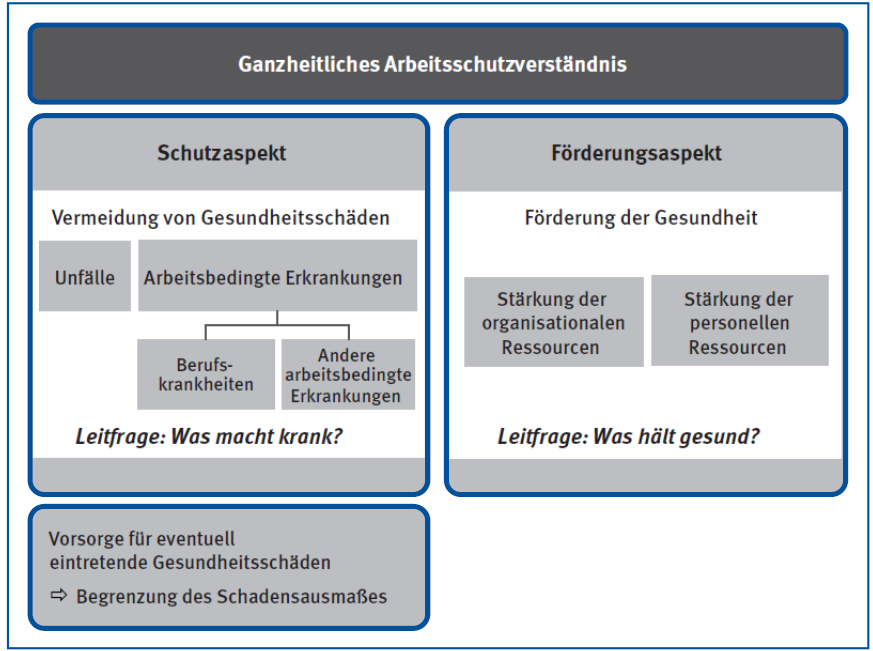<!-- style="max-height: 60vh;" -->

Quelle: DGUV Report 2/2012, S. 19

---

## Die Ergänzung: Selbstverantwortung

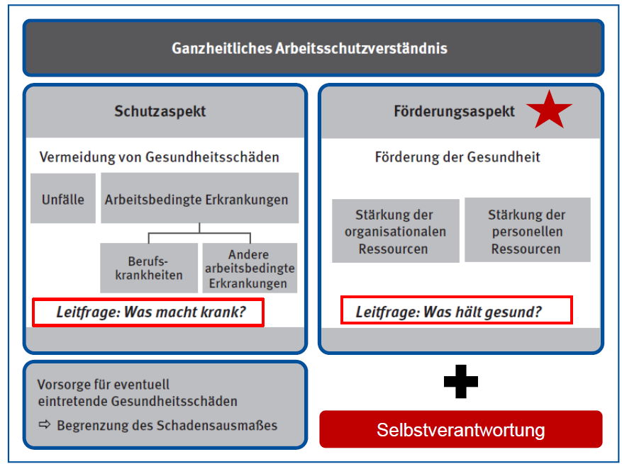<!-- style="max-height: 60vh;" -->

Quelle: DGUV Report 2/2012, S. 19

Ganzheitliches Verständnis = **Schutzaspekt + Förderungsaspekt + Selbstverantwortung**

---

## Wissensstand-Check 4: Leitfragen

Welche Leitfrage gehört zum **Förderungsaspekt**?

- [( )] Was macht krank?
- [(X)] Was hält gesund?
- [( )] Wer haftet?
- [( )] Was ist verboten?

Ergänzen Sie die Definition:

Arbeitsschutz ist Bewahrung von [[Leben]] und [[Gesundheit]] in Verbindung mit der Arbeit.

---

## Mensch – Gefahr – gesundheitsfördernde Faktoren

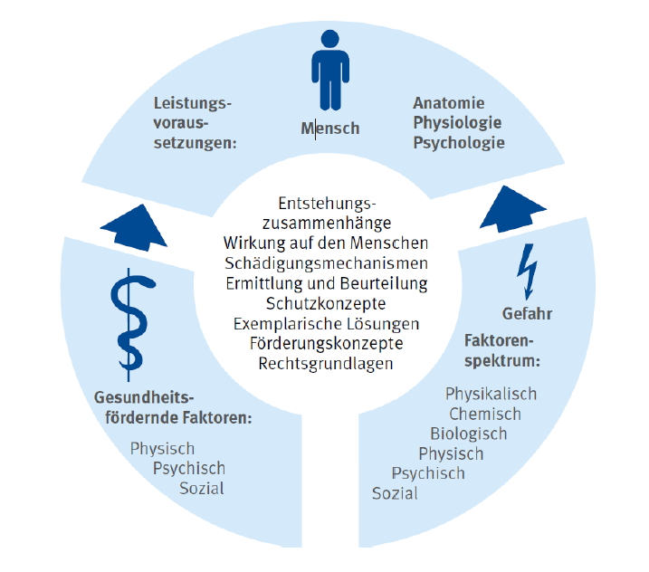<!-- style="max-height: 62vh;" -->

Quelle: DGUV 251-001, S. 10

---

## Gestaltung sicherer Arbeitssysteme: T – O – P

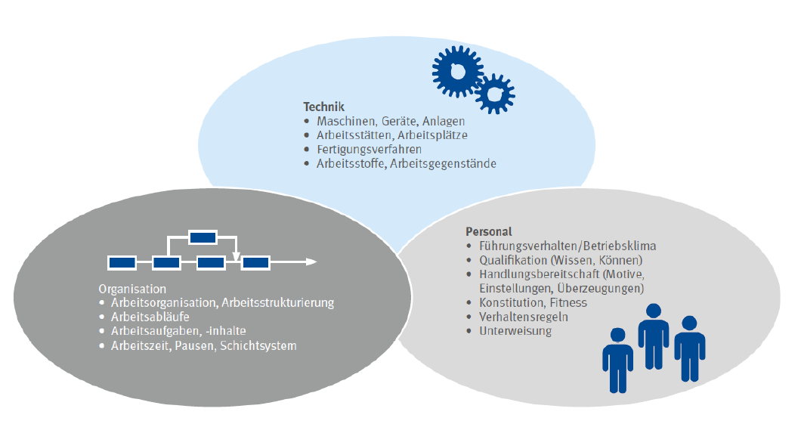<!-- style="max-height: 58vh;" -->

Quelle: DGUV 251-001, S. 10

| **T**echnik | **O**rganisation | **P**ersonal |
|:--|:--|:--|
| Maschinen, Geräte, Anlagen | Arbeitsorganisation, Arbeitsstrukturierung | Führungsverhalten, Betriebsklima |
| Arbeitsstätten, Arbeitsplätze | Arbeitsabläufe | Qualifikation (Wissen, Können) |
| Fertigungsverfahren | Arbeitsaufgaben, -inhalte | Handlungsbereitschaft |
| Arbeitsstoffe, Arbeitsgegenstände | Arbeitszeit, Pausen, Schichtsystem | Konstitution, Fitness, Verhaltensregeln, Unterweisung |

---

## Diskussion: T-O-P an der Prüfmaschine

<!-- style="max-height: 38vh;" -->

**💬 Aufgabe (4 Min., Partnerarbeit, dann Plenum):**

Nennen Sie je Dimension **ein bis zwei Maßnahmen**, mit denen die Prüfmaschine im Labor sicher betrieben werden kann.

- **T**echnik: ?
- **O**rganisation: ?
- **P**ersonal: ?

---

## Block 3: Duales Arbeitsschutzsystem

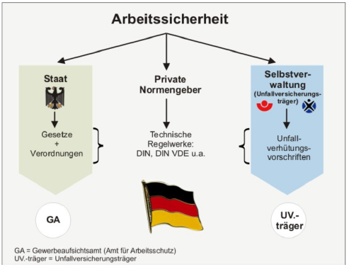<!-- style="max-height: 58vh;" -->

Quelle: Siebert, D.; Hartmann, T. (2010)

| Staat | Private Normgeber | Selbstverwaltung |
|:--|:--|:--|
| Gesetze + Verordnungen | Technische Regelwerke (DIN, DIN VDE u. a.) | Unfallverhütungsvorschriften |
| Gewerbeaufsichtsamt (Amt für Arbeitsschutz) | | Unfallversicherungsträger |

---

## Aufgabenverteilung: Staat und Unfallversicherungsträger

- Die **Verhütung von Arbeitsunfällen, Berufskrankheiten und arbeitsbedingten Gesundheitsgefahren** nehmen **Bund und Länder** als staatliche Aufgabe auf Grundlage des Arbeitsschutzgesetzes wahr (§ 21 ArbSchG).
- Die **Unfallversicherungsträger** sind rechtsfähige **Körperschaften des öffentlichen Rechts mit Selbstverwaltung**. Sie erfüllen ihren Präventionsauftrag als **sozialversicherungsrechtliche Aufgabe** nach dem Siebten Buch Sozialgesetzbuch (§ 1 Nr. 1, §§ 14 ff. SGB VII i. V. m. §§ 29 ff. SGB IV).
- § 21 ArbSchG: Nehmen die Träger der gesetzlichen Unfallversicherung im Rahmen ihres Präventionsauftrags Aufgaben zur Sicherheit und zum Gesundheitsschutz der Beschäftigten wahr, werden sie **ausschließlich im Rahmen ihrer autonomen Befugnisse** tätig.

Quelle: WEKA Arbeitsschutz & Gefahrstoffe (2016)

---

## Das Arbeitsschutzsystem der Bundesrepublik Deutschland

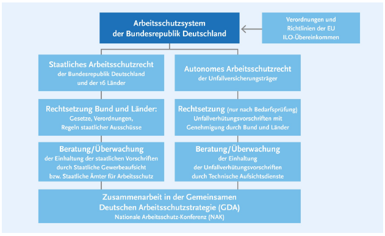<!-- style="max-height: 62vh;" -->

Quelle: Suga (2012), S. 19, Bundesanstalt für Arbeitsschutz und Arbeitsmedizin (BAuA)

---

## Einordnung: EU, Staat und Selbstverwaltung

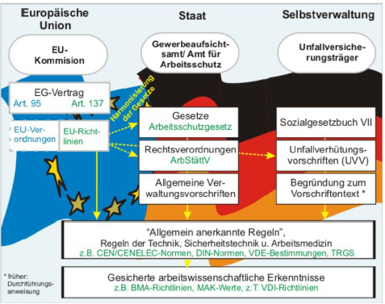<!-- style="max-height: 62vh;" -->

Quelle: [Quelle der Abbildung bitte ergänzen; Folie in der Vorjahrespräsentation ohne Angabe]

- EU-Verordnungen und EU-Richtlinien (Harmonisierung der Gesetze)
- Staat: Arbeitsschutzgesetz, Rechtsverordnungen (z. B. ArbStättV), allgemeine Verwaltungsvorschriften
- Selbstverwaltung: SGB VII, Unfallverhütungsvorschriften (UVV)
- darunter: „allgemein anerkannte Regeln" (CEN/CENELEC-, DIN-Normen, VDE-Bestimmungen, TRGS) und gesicherte arbeitswissenschaftliche Erkenntnisse (z. B. MAK-Werte, VDI-Richtlinien)

---

## Wissensstand-Check 5: Wer macht was?

Wer erlässt **Unfallverhütungsvorschriften**?

- [( )] Der Bundestag
- [( )] Das Gewerbeaufsichtsamt
- [(X)] Die Unfallversicherungsträger (Selbstverwaltung)
- [( )] Das DIN
********************

Unfallverhütungsvorschriften gehören zum autonomen Recht der Unfallversicherungsträger (Selbstverwaltung).

********************

Wer überwacht die Einhaltung der **staatlichen** Vorschriften?

- [( )] Die Technischen Aufsichtsdienste der Unfallversicherungsträger
- [(X)] Die Staatliche Gewerbeaufsicht bzw. die Ämter für Arbeitsschutz
- [( )] Der Betriebsrat
- [( )] Die Fachkraft für Arbeitssicherheit
********************

Die staatliche Gewerbeaufsicht überwacht das staatliche Recht, die Technischen Aufsichtsdienste überwachen die Unfallverhütungsvorschriften. Zuständige Behörde in Sachsen-Anhalt laut Vorjahresfolie: Landesamt für Verbraucherschutz.

********************

---

## Block 4: Gesetze, Verordnungen, Vorschriften, Regeln und Normen

Leitfrage: **Was ist wie verbindlich?**

- EU-Richtlinie
- Gesetz
- Verordnung
- Technische Regel
- Norm / VDI-Richtlinie

Quelle: EUR-Lex, Richtlinien der Europäischen Union; Deutscher Bundestag; ifa, Erläuterungen zum Regelwerk

---

## Richtlinien der Europäischen Union

Ein **Rechtsakt mit allgemeiner Geltung**.

Artikel 288 des Vertrags über die Arbeitsweise der EU besagt:

- Richtlinien sind für jedes EU-Land, an das sie gerichtet sind, **hinsichtlich des zu erreichenden Ziels verbindlich**,
- den innerstaatlichen Stellen bleibt jedoch die **Wahl der Form und der Mittel** überlassen.

| Rechtsakt | Eigenschaft |
|:--|:--|
| **Richtlinie** | nicht sofort gültig, muss zunächst in nationales Recht umgesetzt werden; Text mit allgemeiner Geltung, an alle EU-Länder gerichtet |
| **Verordnung** | gilt unmittelbar nach Inkrafttreten in den EU-Ländern |
| **Beschluss** | unterscheidet sich von der Richtlinie, da diese ein Text mit allgemeiner Geltung ist |

Quelle: EUR-Lex, Richtlinien der Europäischen Union

---

## Gesetze und Verordnungen = Rechtsvorschriften

- **Gesetze** schreiben **allgemeine Schutzziele** vor.
- Die Befolgung der Forderungen von Gesetzen und Verordnungen ist **zwingend**.
- Der **Grad der Spezifizierung** steigt von Gesetzen über Verordnungen zu Vorschriften.

**Rechtsverordnungen**

- sind Gesetze, die nicht im förmlichen Gesetzgebungsverfahren vom Bundestag verabschiedet, sondern von **Bundesregierung, Bundesminister oder Landesregierung** erlassen werden,
- die **Ermächtigung** muss in einem Gesetz verankert sein; Zweck und Ausmaß bestimmt das ermächtigende Gesetz,
- dürfen nicht gegen das Recht der Europäischen Gemeinschaft, die Grundrechte, das Verhältnismäßigkeitsprinzip und den Gleichheitssatz verstoßen,
- können durch ein formelles Gesetz jederzeit wieder aufgehoben werden.

Quelle: Deutscher Bundestag

---

## Regelwerke: Technische Regeln

- generell **nicht rechtsverbindlich**
- **Konkretisierung** von Gesetzen und Verordnungen, dienen als **Orientierungshilfe**
- enthalten Empfehlungen und technische Vorschläge zur Umsetzung der Forderungen
- **Vermutungswirkung:** Bei Erfüllung der Regel werden die Gesetze bzw. Pflichten erfüllt
- **Regelabweichungen** sind unter Einhaltung der Gesetze möglich, um wissenschaftlichen und technischen Fortschritt nicht zu behindern

Quelle: ifa, Erläuterungen zum Regelwerk

---

## Normen und VDI-Richtlinien

**Normen**

- nicht rechtsverbindlich, Konkretisierung der europäischen und deutschen Regelwerke, Orientierungshilfe in konkreten Fällen
- Empfehlungen auf Basis gesicherter wissenschaftlicher Erkenntnisse und Erfahrungen
- Organisation und Durchführung der Normungsarbeit in Deutschland u. a. durch das **Deutsche Institut für Normung (DIN)**
- Ausschüsse bestehen aus Fachleuten aus Unternehmen, Handel, Hochschulen, Verbraucherkreisen, Handwerk, Prüfinstituten und Behörden
- auf europäischer bzw. internationaler Ebene: **EN- bzw. ISO-Normen**

**VDI-Richtlinien**

- Der Verein Deutscher Ingenieure hat ein eigenständiges technisches Regelwerk aufgebaut.
- Die ca. 2000 VDI-Richtlinien werden von Experten aus Industrie und Wissenschaft erarbeitet und stellen **anerkannte Regeln der Technik** dar.

Quelle: ifa, Erläuterungen zum Regelwerk

---

## Systematik des Arbeitsschutzrechts

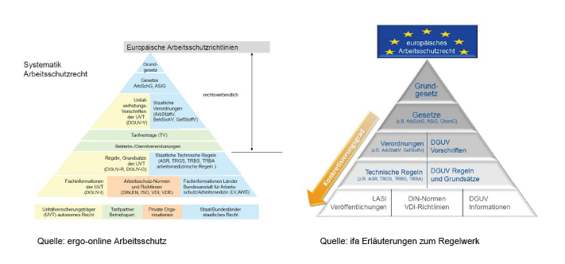<!-- style="max-height: 58vh;" -->

Quelle: ergo-online, Arbeitsschutz · ifa, Erläuterungen zum Regelwerk

- **Konkretisierungsgrad** steigt von oben nach unten: Grundgesetz → Gesetze (ArbSchG, ASiG, ChemG) → Verordnungen (ArbStättV, BetrSichV, GefStoffV) bzw. DGUV Vorschriften → Technische Regeln (ASR, TRGS, TRBS, TRBA) bzw. DGUV Regeln → DIN-Normen, VDI-Richtlinien, DGUV Informationen
- **Rechtsverbindlich** ist der Bereich von Grundgesetz bis Verordnungen bzw. Unfallverhütungsvorschriften (links in der Abbildung mit Klammer markiert), darunter Tarifverträge und Betriebs-/Dienstvereinbarungen
- Staatliches Recht (Staat/Bundesländer) und autonomes Recht (Unfallversicherungsträger) stehen nebeneinander

---

## Das Gesetzgebungsverfahren des Bundes

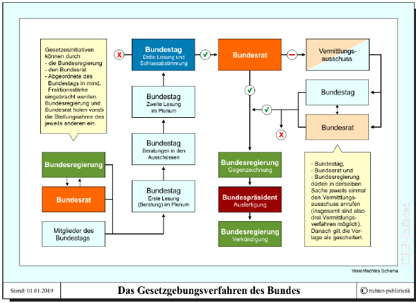<!-- style="max-height: 62vh;" -->

Quelle: richter-publizistik, „Das Gesetzgebungsverfahren des Bundes", Stand 01.01.2019

1. **Initiative:** Bundesregierung, Bundesrat oder Abgeordnete des Bundestags (in mindestens Fraktionsstärke)
2. **Bundestag:** erste Lesung (Beratung) im Plenum → Beratungen in den Ausschüssen → zweite Lesung → dritte Lesung und Schlussabstimmung
3. **Bundesrat**, bei Konflikten ggf. **Vermittlungsausschuss**
4. **Bundesregierung** (Gegenzeichnung) → **Bundespräsident** (Ausfertigung) → **Verkündung**

---

## Übersicht: Rechtsvorschriften im Arbeitsschutz (Auswahl)

| Rechtsvorschrift | Typischer Gegenstand |
|:--|:--|
| Arbeitsschutzgesetz (ArbSchG) | Grundpflichten des Arbeitgebers |
| Arbeitsstättenverordnung (ArbStättV) | Gestaltung von Arbeitsstätten |
| Betriebssicherheitsverordnung (BetrSichV) | Arbeitsmittel, überwachungsbedürftige Anlagen |
| Gefahrstoffverordnung (GefStoffV) | Umgang mit gefährlichen Stoffen |
| Verordnung zur arbeitsmedizinischen Vorsorge | Vorsorge der Beschäftigten |
| PSA-Benutzungsverordnung | persönliche Schutzausrüstung |
| Lärm- und Vibrations-Arbeitsschutzverordnung | Schutz vor Lärm und Vibrationen |
| Verordnung zum Schutz vor künstlicher optischer Strahlung | optische Strahlung |
| Lastenhandhabungsverordnung | Handhabung von Lasten |
| Biostoffverordnung | biologische Arbeitsstoffe |
| Baustellenverordnung | Baustellen |

Weitere: Arbeitssicherheitsgesetz (ASiG), DGUV Vorschrift 2, Bundesimmissionsschutzgesetz/-verordnung, Gentechnik-Sicherheitsverordnung, Chemikaliengesetz. Für die Ausbildung Jugendlicher gilt zusätzlich das **Jugendarbeitsschutzgesetz (JArbSchG)**.

Quelle: BMAS, Was ist Arbeitsschutz? · vdf Hochschulverlag AG an der ETH Zürich

---

## Wissensstand-Check 6: Verbindlichkeit ordnen

Ordnen Sie zu:

„Gibt ein Ziel vor, das jedes betroffene EU-Land erreichen muss, ohne Vorgabe der Mittel."

[[(Richtlinie)|Verordnung|Beschluss|Technische Regel]]

„Gilt nach Inkrafttreten sofort und unmittelbar in allen EU-Ländern."

[[Richtlinie|(Verordnung)|Beschluss|Norm]]

„Schreibt allgemeine Schutzziele vor, die Befolgung ist zwingend."

[[(Gesetz)|Technische Regel|Norm|VDI-Richtlinie]]

„Nicht rechtsverbindlich, aber bei Erfüllung greift die Vermutungswirkung."

[[Gesetz|Verordnung|(Technische Regel)|Richtlinie]]

Welche Aussagen zu **Normen** sind richtig? (Mehrfachauswahl)

- [[X]] Sie sind nicht rechtsverbindlich.
- [[X]] Sie konkretisieren europäische und deutsche Regelwerke.
- [[ ]] Sie werden vom Bundestag beschlossen.
- [[X]] Sie werden u. a. vom DIN erarbeitet.

---

## Diskussion: Vermutungswirkung

**💬 Austausch (3 Min.)**

Technische Regeln sind **nicht rechtsverbindlich**, aber es gilt die **Vermutungswirkung**.

1. Was bedeutet das praktisch für Sie als Lehrkraft, die ein Labor einrichtet?
2. Wann könnte eine **Regelabweichung** sinnvoll sein, und was müssten Sie dann nachweisen?

---

## Block 5: Institutionen des Arbeitsschutzes

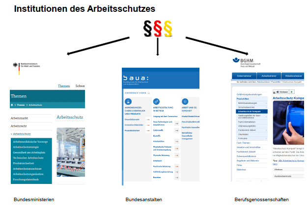<!-- style="max-height: 50vh;" -->

Bundesministerien (z. B. BMAS) · Bundesanstalten (z. B. BAuA) · Berufsgenossenschaften (z. B. BGHM)

Die **gesetzliche Unfallversicherung** ist ein Zweig der Sozialversicherung. Als Pflichtversicherung gleicht sie Gesundheitsschäden aus, die Versicherte infolge einer versicherten Tätigkeit erleiden. Gesetzliche Grundlage ist das Siebte Buch Sozialgesetzbuch (SGB VII).

Quelle: DGUV, https://dguv.de/de/index.jsp

---

## Betriebliche Ebene: Fallbeispiel Produktionsbetrieb

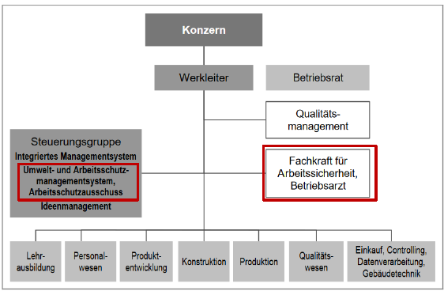<!-- style="max-height: 55vh;" -->

Quelle: DGUV (2011), Handlungshilfen Betriebliche Anwendungsbeispiele

- Steuerungsgruppe: integriertes Managementsystem (Umwelt- und Arbeitsschutzmanagementsystem, Arbeitsschutzausschuss, Ideenmanagement)
- Fachkraft für Arbeitssicherheit und Betriebsarzt als beratende Stabsstellen neben Werkleiter, Betriebsrat und Qualitätsmanagement
- Fachbereiche: Lehrausbildung, Personalwesen, Produktentwicklung, Konstruktion, Produktion, Qualitätswesen, Einkauf/Controlling/Datenverarbeitung/Gebäudetechnik

---

## Rollen und Aufgaben betrieblicher Akteure

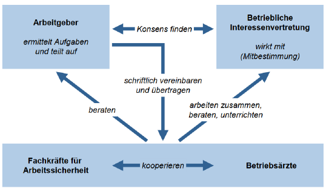<!-- style="max-height: 50vh;" -->

Quelle: wiwiweb.de, Arbeitssicherheit und Arbeitsschutz (2020) · DGUV (2011), Handlungshilfen Betriebliche Anwendungsbeispiele

- **Arbeitgeber:** ermittelt Aufgaben und teilt sie auf, vereinbart schriftlich und überträgt
- **Betriebliche Interessenvertretung:** wirkt mit (Mitbestimmung); Konsens mit Arbeitgeber
- **Fachkräfte für Arbeitssicherheit und Betriebsärzte:** kooperieren, beraten den Arbeitgeber, arbeiten mit der Interessenvertretung zusammen, beraten und unterrichten

---

## Fachkraft für Arbeitssicherheit (Sifa)

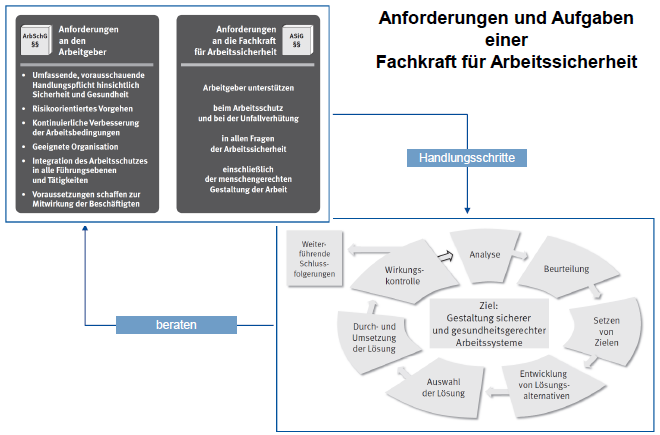<!-- style="max-height: 50vh;" -->

Quelle: DGUV, Sifa – Fachkraft für Arbeitssicherheit (2020)

- betrieblicher **Berater** nach ASiG, unterstützt den Arbeitgeber in **allen Fragen des Arbeitsschutzes**
- Rechtsstellung nach ASiG: fachlicher Berater; ihr Handeln ist mitentscheidend für das **Niveau von Sicherheit und Gesundheitsschutz**
- Fachkunde: erfolgreiche Teilnahme an einem staatlichen oder berufsgenossenschaftlichen (bzw. anerkannten) Ausbildungslehrgang (z. B. Sifa-Ausbildungslehrgang der DGUV)
- Zuständige Behörde in Sachsen-Anhalt: Landesamt für Verbraucherschutz des Landes Sachsen-Anhalt
- Handlungsschritte (Regelkreis): Analyse → Beurteilung → Setzen von Zielen → Entwicklung von Lösungsalternativen → Auswahl der Lösung → Durch- und Umsetzung → Wirkungskontrolle → weiterführende Schlussfolgerungen

---

## Betriebsarzt

**Qualifikation** (Facharzt für Arbeitsmedizin): Der Facharzttitel wird von der zuständigen Landesärztekammer verliehen, wenn der Arzt

- mindestens **4 Jahre** in festgelegten Fachgebieten, davon mindestens **21 Monate** in der praktischen Arbeitsmedizin,
- in für die Weiterbildung zugelassenen Einrichtungen ärztlich tätig war,
- einen **dreimonatigen theoretischen Kurs** in Arbeitsmedizin absolviert und eine Prüfung vor der Ärztekammer bestanden hat.

Die Fachkunde wird auch mit der Zusatzbezeichnung **Betriebsmedizin** nachgewiesen.

Quelle: Mayer (2020), auf Haufe.de

---

## Aufgaben des Betriebsarztes

Betriebsärzte **beraten den Arbeitgeber**, insbesondere bei

- der Beurteilung der Arbeitsbedingungen (Gefährdungsbeurteilung),
- Planung, Ausführung und Unterhaltung von Anlagen und Einrichtungen,
- Beschaffung und Einsatz von Arbeitsmitteln, -verfahren und -stoffen,
- Gestaltung von Arbeitsplätzen, Arbeitsorganisation und Arbeitsumgebung,
- der arbeitsmedizinischen Vorsorge,
- Erster Hilfe und sonstigen Notfallmaßnahmen.

Sie haben außerdem die Arbeitnehmer zu **untersuchen und zu beraten** sowie die Untersuchungsergebnisse zu erfassen und auszuwerten.

Quelle: Huck; Mayer (2020), auf Haufe.de

---

## Wissensstand-Check 7: Welche Rolle?

Ein Produktionsbetrieb führt eine neue Maschine ein. Wer **berät den Arbeitgeber in allen Fragen des Arbeitsschutzes**?

- [( )] Der Betriebsrat
- [(X)] Die Fachkraft für Arbeitssicherheit
- [( )] Die Belegschaft
- [( )] Der Unfallversicherungsträger

Wer ist für die **arbeitsmedizinische Vorsorge** zuständig?

- [( )] Die Fachkraft für Arbeitssicherheit
- [(X)] Der Betriebsarzt
- [( )] Das Gewerbeaufsichtsamt

---

## Block 6: Zusammenfassung

<!-- style="max-height: 28vh;" -->

**Zurück zum Einstieg:** Wer ist verantwortlich? Welche Regeln gelten?

1. **Wandel der Arbeitswelt** (sechs Trends) verlangt vernetzten, proaktiven, systemhaften Arbeitsschutz.
2. **Arbeitsschutz** = Bewahrung von Leben und Gesundheit: Schutz **und** Förderung **plus** Selbstverantwortung; Gestaltung von Arbeitssystemen über **T-O-P**.
3. **Duales System:** Staat (Gesetze, Verordnungen, Aufsicht) + Unfallversicherungsträger (Unfallverhütungsvorschriften, Selbstverwaltung) + private Normgeber.
4. **Verbindlichkeit:** Richtlinie (EU, Umsetzung nötig) → Gesetz → Verordnung (zwingend) → Technische Regel/Norm (nicht verbindlich, aber **Vermutungswirkung**).
5. **Betriebliche Akteure:** Arbeitgeber, Betriebsrat, **Fachkraft für Arbeitssicherheit**, **Betriebsarzt**.

---

## Überleitung zur Aktivierung

Jetzt wenden Sie das Gelernte an.

> Ein Hinweis zum Transfer: Das Arbeitsschutzgesetz schützt **Beschäftigte**. Für Schülerinnen und Schüler im Schullabor gelten teils andere Regelungen (Thema des nächsten Gruppen-Inputs „Sicherheit in Schulen"). Heute übertragen wir die Systematik zunächst auf einen **Ausbildungsbetrieb**.

**Weiter mit: Fallstudie (20 Min.)**

---

## Aktivierung: Methode Fallstudie

**Was ist eine Fallstudie?**

Sie bearbeiten einen realitätsnahen Fall, für den es mehrere vertretbare Lösungen gibt, und begründen Ihre Entscheidung mit dem Gelernten.

**Warum diese Methode?**

- Wissen wird auf eine konkrete Handlungssituation **angewendet** (Lernziel 6)
- passt zum Laborbezug: Einführung einer Maschine bzw. eines Lernsystems
- es gibt keine „eine richtige Antwort", sondern **begründete Empfehlungen**

Literatur zur Methode (Arbeitsblatt Unterrichtsmethoden): Zendler, A. (2018). *Unterrichtsmethoden für MINT-Fächer.* · Wiechmann, J.; Wildhirt, S. (2016). *Zwölf Unterrichtsmethoden. Vielfalt für die Praxis.* · http://methodenpool.uni-koeln.de/download.html · Leonardo-Projekt (o. J.), Baustein 2. · Qualitäts- und Unterstützungsagentur – Landesinstitut für Schule (2018), Methodensammlung.

---

## Fallstudie: Ihr Auftrag auf einen Blick

> Sie sind zu zweit ein **Beratungsteam**. Die **Geschäftsführung** (der Dozent) möchte eine Prüfmaschine einführen und braucht von Ihnen eine **Empfehlung**, wie das rechtssicher und gesundheitsgerecht gelingt. **Am Ende entscheidet die Geschäftsführung.**

| Phase | Was passiert? | Zeit |
|:--|:--|--:|
| 1 | **Fall lesen** (beide) | 2 Min. |
| 2 | **Beratungsvorlage erarbeiten:** Person A klärt die Rechtsquellen, Person B die Akteure und Maßnahmen. Danach führen Sie beides zusammen. | 8 Min. |
| 3 | **Empfehlung vortragen**, die Geschäftsführung fragt nach und **entscheidet** | 6 Min. |
| 4 | **Auswertung** und Reflexion | 4 Min. |

**Ihr Ergebnis:** eine Seite (Blatt oder Flipchart) mit höchstens **5 Kernaussagen**, die Sie der Geschäftsführung vortragen.

---

## Fallstudie: Der Fall (Phase 1, 2 Min.)

<!-- style="max-height: 35vh;" -->

**Situation:** Ein überbetriebliches Ausbildungszentrum der Metalltechnik beschafft für sein Werkstofflabor eine **Universalprüfmaschine** (Z600, F max = 600 kN) mit Steuerrechner und Handbediengerät. Geplant sind Zugversuche mit Auszubildenden, teils unter 18 Jahre.

Das Zentrum hat Arbeitgeber (Geschäftsführung), Betriebsrat, eine Fachkraft für Arbeitssicherheit und einen Betriebsarzt. Die Aufstellung erfolgt in einem Laborraum mit Bestand.

**Leitfrage der Geschäftsführung:** Was muss geklärt und getan werden, damit die Maschine **rechtssicher und gesundheitsgerecht** eingeführt und betrieben wird?

---

## Fallstudie: Phase 2 – Ihre Rollen (8 Min.)

Arbeiten Sie **zuerst ca. 4 Min. getrennt**, danach ca. **4 Min. gemeinsam** (nächste Folie).

**Person A: Rechtsberater/in** (Welche Regeln gelten?)

Füllen Sie eine Tabelle mit **mindestens 5 Zeilen** aus:

| Rechtsquelle | Ebene | verbindlich? | Was regelt sie hier? |
|:--|:--|:--|:--|
| *Beispiel:* Betriebssicherheitsverordnung | Verordnung | ja | Bereitstellung und Benutzung der Prüfmaschine als Arbeitsmittel |
| ... | ... | ... | ... |

Markieren Sie zusätzlich: **Wo greift die Vermutungswirkung?**

**Person B: Arbeitsschutz-Organisator/in** (Wer tut was? Welche Maßnahmen?)

1. **Wer ist beteiligt, und was tut er/sie?** (Arbeitgeber, Betriebsrat, Fachkraft für Arbeitssicherheit, Betriebsarzt, Unfallversicherungsträger, staatliche Aufsicht)

   *Beispiel:* Fachkraft für Arbeitssicherheit: berät die Geschäftsführung in allen Fragen des Arbeitsschutzes.
2. Nennen Sie **je zwei Maßnahmen** für **T**echnik, **O**rganisation und **P**ersonal.
3. Was gilt **zusätzlich für Auszubildende unter 18**?

*Hilfsmittel:* die Folien dieser Präsentation und Ihre Notizen.

---

## Fallstudie: Phase 2 – Zusammenführen (letzte 4 Min.)

Legen Sie Ihre Ergebnisse nebeneinander und formulieren Sie **gemeinsam** eine Empfehlung an die Geschäftsführung:

1. Wo passen Rechtsquellen (A) und Maßnahmen (B) **zusammen**? Wo gibt es Lücken oder Widersprüche?
2. Schreiben Sie **höchstens 5 Kernaussagen** auf, jeweils im Format:

   **„Wir empfehlen ..., weil ..."**

3. Legen Sie fest, **wer was vorträgt**.

---

## Fallstudie: Phase 3 – Vortrag und Entscheidung (6 Min.)

1. **Beratungsteam trägt vor** (ca. 3 Min.): Beide stellen ihre Empfehlung vor (Recht und Akteure/Maßnahmen).
2. **Geschäftsführung fragt nach** (ca. 2 Min.), zum Beispiel:
   - „Reicht es, wenn wir nur die DIN-Normen einhalten?"
   - „Wer trägt die Verantwortung, wenn trotzdem etwas passiert?"
   - „Was kostet uns eine Regelabweichung, und was müssen wir dann nachweisen?"
3. **Geschäftsführung entscheidet** (ca. 1 Min.) und begründet:
   - **Freigabe**, oder
   - **Freigabe mit Auflagen**, oder
   - **keine Freigabe**, bis nachgebessert wird

---

## Fallstudie: Auswertung (Phase 4, 4 Min.)

**Abgleich mit dem Erwartungshorizont** (nächste Folie) und kurze **Reflexion**:

1. Welche Zuordnung war unsicher (z. B. Verordnung vs. Technische Regel)?
2. Wie eignet sich die Methode **Fallstudie** für Ihren späteren Unterricht im Labor?
3. *KI-Bezug:* Wie könnte ein KI-Werkzeug beim **Entwerfen** eines solchen Falls helfen, und was müssten Sie **fachlich prüfen**?

---

## Erwartungshorizont (Moderationsfolie)

**Rechtsquellen (Beispiele)**

| Ebene | Beispiel | Verbindlich? |
|:--|:--|:--|
| EU | Richtlinien des europäischen Arbeitsschutzrechts (Umsetzung nötig)* | ja, nach Umsetzung |
| Gesetz | ArbSchG, ASiG, JArbSchG (für Jugendliche) | ja |
| Verordnung | BetrSichV (Arbeitsmittel), ArbStättV (Raum), PSA-BV, Lärm-/Vibrationsverordnung | ja |
| Unfallverhütungsvorschrift | DGUV Vorschrift 2 (Betreuung durch Fachkraft/Betriebsarzt) | ja (autonomes Recht) |
| Technische Regel | z. B. TRBS | nein, aber **Vermutungswirkung** |
| Norm | DIN/EN/ISO-Normen zur Maschinensicherheit | nein |

**Akteure:** Arbeitgeber (Verantwortung, Organisation), Fachkraft für Arbeitssicherheit (berät), Betriebsarzt (arbeitsmedizinische Vorsorge, Beratung bei Gefährdungsbeurteilung), Betriebsrat (Mitbestimmung), Unfallversicherungsträger (Prävention, Unfallverhütungsvorschriften, Technische Aufsichtsdienste), staatliche Aufsicht (Landesamt für Verbraucherschutz Sachsen-Anhalt).

**T-O-P (Beispiele)**

- **Technik:** funktionsfähiger Not-Halt, Schutzeinrichtungen, Warn-/Gebotszeichen (z. B. Gehörschutz), geprüfte Elektrik
- **Organisation:** Zugangs- und Prüfablauf regeln, Betriebsanweisung, Aufsicht bei Auszubildenden, Prüfintervalle
- **Personal:** Qualifikation, Unterweisung vor Erstbenutzung, Verhaltensregeln, Eignung/Fitness

**Auszubildende unter 18:** zusätzlich Jugendarbeitsschutzgesetz (JArbSchG).

*\*Ergänzend (prüfen):* Für die Maschine als Produkt gilt das EU-Produktrecht (Maschinenrichtlinie; die neue EU-Maschinenverordnung gilt ab Januar 2027).

---

## Schlusswort und Diskussion

**Danke für die Aufmerksamkeit!**

Offene Fragen? Diskussion?

*Nächster Gruppen-Input: „Sicherheit in Schulen"*

---

## Quellenverzeichnis

**Quellen aus der Vorjahrespräsentation (Folienbelege)**

- BMAS (o. J.). *Was ist Arbeitsschutz?* Bundesministerium für Arbeit und Soziales.
- Deutsche Gesetzliche Unfallversicherung (DGUV) (o. J.). *DGUV 251-001* (S. 10).
- Deutsche Gesetzliche Unfallversicherung (DGUV) (2012). *DGUV Report 2/2012* (S. 18–19).
- Deutsche Gesetzliche Unfallversicherung (DGUV) (2011). *Handlungshilfen. Betriebliche Anwendungsbeispiele.*
- Deutsche Gesetzliche Unfallversicherung (DGUV) (2020). *Sifa – Fachkraft für Arbeitssicherheit.*
- Deutsche Gesetzliche Unfallversicherung (DGUV) (o. J.). https://dguv.de/de/index.jsp
- Deutscher Bundestag (o. J.). *Gesetze und Verordnungen; Rechtsverordnungen.*
- ergo-online (o. J.). *Arbeitsschutz.* [Systematik Arbeitsschutzrecht]
- EUR-Lex (o. J.). *Richtlinien der Europäischen Union.*
- ifa (o. J.). *Erläuterungen zum Regelwerk.* Institut für Arbeitsschutz der DGUV.
- Huck; Mayer (2020). Auf Haufe.de. [Aufgaben des Betriebsarztes]
- Mayer (2020). Auf Haufe.de. [Qualifikation des Betriebsarztes]
- richter-publizistik (2019). *Das Gesetzgebungsverfahren des Bundes.* Stand 01.01.2019.
- Siebert, D.; Hartmann, T. (2010). [Das duale Arbeitsschutzsystem in Deutschland]
- Suga (2012). S. 19. Bundesanstalt für Arbeitsschutz und Arbeitsmedizin (BAuA). [Bestandteile des zeitgemäßen Arbeitsschutzes; Schreibweise des Namens bitte prüfen]
- vdf Hochschulverlag AG an der ETH Zürich (o. J.). [Gesetze, Vorschriften, Verordnungen]
- WEKA (2016). *Arbeitsschutz & Gefahrstoffe.*
- wiwiweb.de (2020). *Arbeitssicherheit und Arbeitsschutz.*
- ZwickRoell (o. J.). Produktabbildung Universalprüfmaschine Z600. [Quelle bitte prüfen]

**Quellen zur Methode Fallstudie (Arbeitsblatt Unterrichtsmethoden, WiSe 2026/27, Dr. K. Petzold-Rudolph, 11.11.2026)**

- Zendler, A. (2018). *Unterrichtsmethoden für MINT-Fächer. Bausteine für die Verbesserung von Lernwirksamkeit und Unterrichtsqualität.*
- Wiechmann, J.; Wildhirt, S. (2016). *Zwölf Unterrichtsmethoden. Vielfalt für die Praxis.*
- Methodenpool Universität Köln (o. J.). http://methodenpool.uni-koeln.de/download.html
- Leonardo-Projekt (o. J.). *Baustein 2. Handlungsorientierte Unterrichtsmethoden.* https://www.goethe.de/resources/files/pdf22/daf_baustein2.pdf
- Qualitäts- und Unterstützungsagentur – Landesinstitut für Schule (2018). *Methodensammlung.* https://www.schulentwicklung.nrw.de/methodensammlung/
